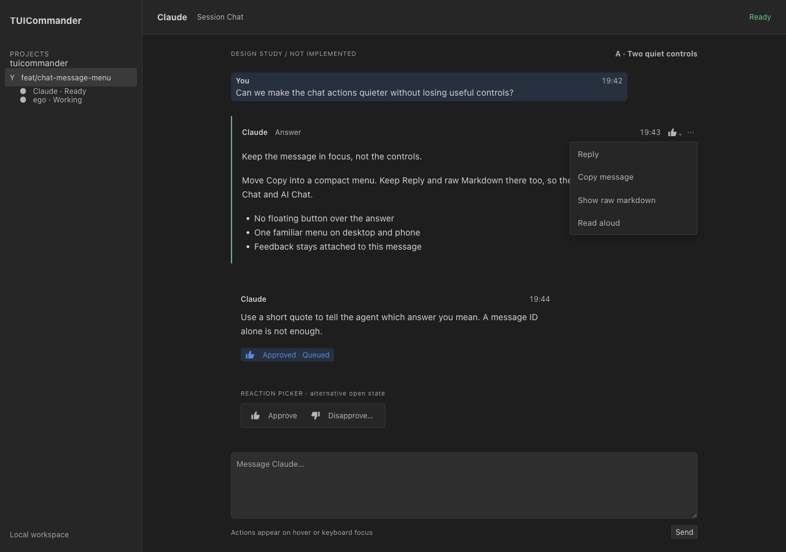
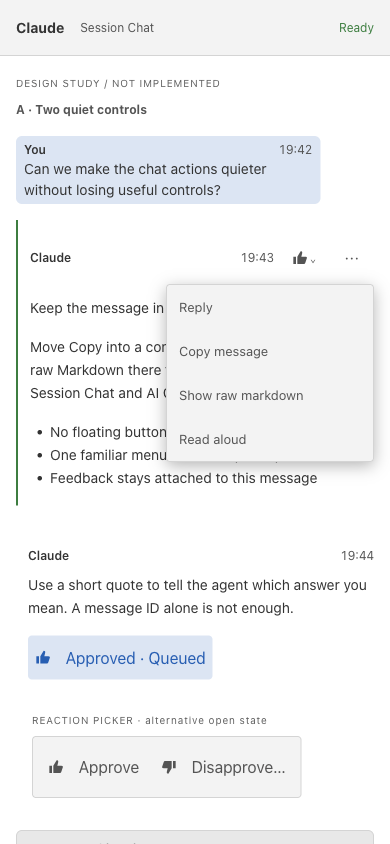
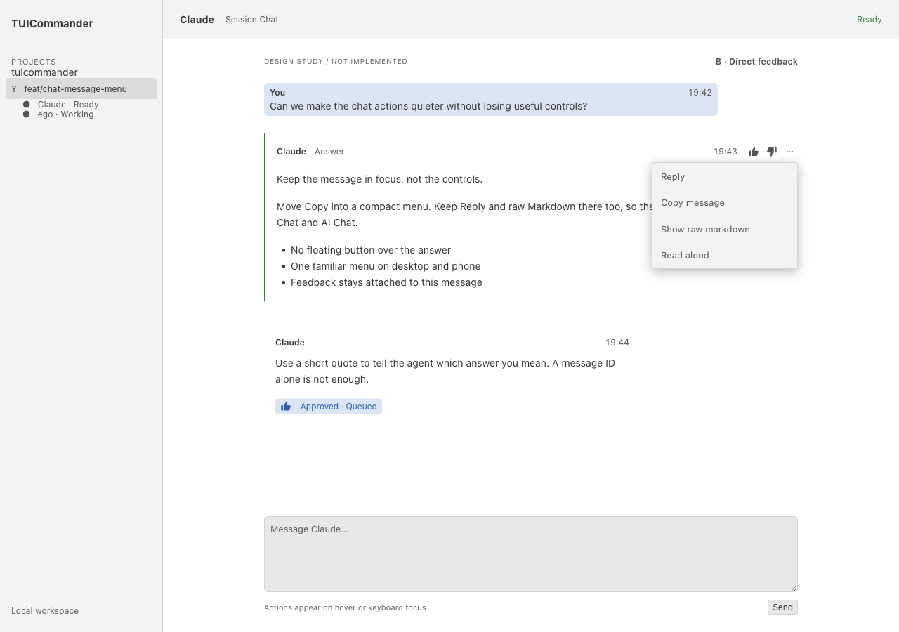
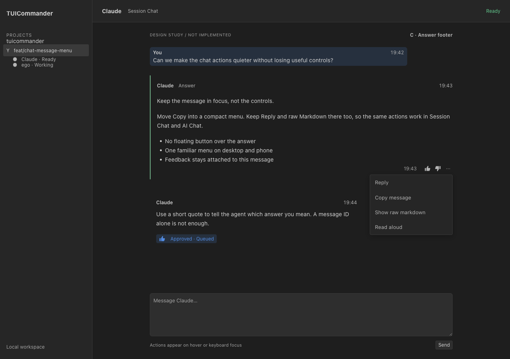
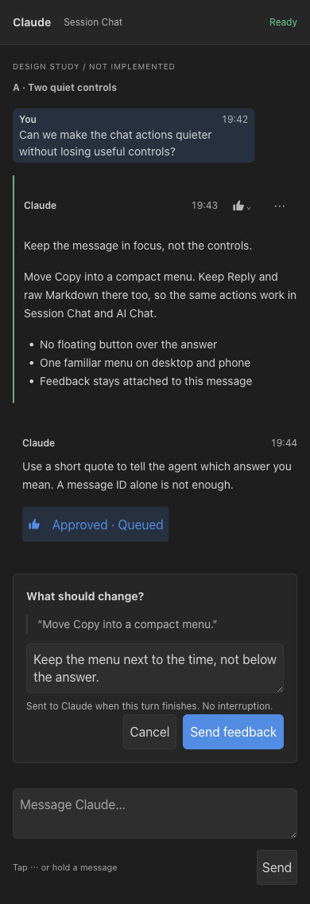

# Chat message actions and response feedback

Date: 2026-10-30

Status: **Message menus shipped in 2539-6c53. Conversational reactions supersede the binary feedback proposal in 2872-6aff.**

Story: **2539-6c53**

Branch: `feat/chat-message-menu`

## Approved implementation scope (2026-11-06)

Story 2872-6aff keeps one existing overflow menu, not a separate reaction trigger. It offers
thumbs up/down, heart, celebrate and a separate comment field on completed AI Chat answers with
native IDs. These are conversational marks, not evaluations. Additions and removals send the exact
source ID and a bounded quote through the original conversation queue. Backend configuration
stores accepted marks; a mark does not prove model consumption. Offline failures leave marks
unchanged. Terminal Chat keeps its existing draft feedback. The earlier alternatives and binary
approval wording below are historical design research, not the implemented reaction contract.

### Production-component browser evidence (2026-11-06)

The real AI Chat `Transcript`, `MessageMenu`, shared controls, and styles were rendered in a
worktree Vite page at `127.0.0.1:18472`. The conversation and callback state are synthetic;
these images verify production-component layout, not a model response or a full application
backend round trip. The named browser session was closed after capture. Both viewport checks
reported a menu left edge of 8px, all menu edges inside the viewport, and no horizontal overflow.
The reacted captures show the persistent mark through the same production component callback.
Backend acceptance/persistence/offline behavior is covered separately by the targeted tests.

| Layout | Menu at the left edge | Reacted answer |
| --- | --- | --- |
| Desktop (1400 × 900) | [PNG](chat-message-actions/evidence/reactions-2872-desktop-menu.png) | [PNG](chat-message-actions/evidence/reactions-2872-desktop-reacted.png) |
| Mobile (390 × 844) | [PNG](chat-message-actions/evidence/reactions-2872-mobile-menu.png) | [PNG](chat-message-actions/evidence/reactions-2872-mobile-reacted.png) |

Raw browser transcript and geometry: `~/Gits/.tmp/chat-reactions-visual/`. Two standalone headless
browser attempts timed out before capture; the required stealth wrapper completed all four
captures and cleanup. No daily app, owner conversation, or provider API was used.

## Recommendation

Use **Option A: two quiet controls beside the message metadata**:

1. A monochrome reaction button opens **Approve response** and **Disapprove response**.
2. **⋯** opens the message actions menu.

Show these controls on desktop hover or keyboard focus. Keep ⋯ visible on touch screens and also support a message long press. Put the selected reaction in a small persistent chip below the response. Use thumb SVGs, not colored emoji, to match the app style guide.

A reaction means feedback about the answer, **not permission to run a command**. It does not approve a pending tool request, apply code, cancel work, or train the vendor model. Send a readable quote with the feedback, not a bare message ID. Queue it for the next safe turn by default; do not interrupt the current turn.

**Decision:**

- [ ] **A — Recommended:** reaction picker + ⋯ beside the time, when a real source time exists. Lowest visual noise; reaction takes two clicks.
- [ ] **B:** separate approve, disapprove and ⋯ controls. One-click positive feedback; more controls on every active message.
- [ ] **C:** the same three controls below the answer. Easy to find after reading; adds a footer and is farther from the requested reference.

The supplied reference is `/Users/stefano.straus/Gits/.tmp/chat-msg-menu/reference.png`. The design keeps its reaction-plus-overflow idea, not its unsupported Pin and Copy ID actions.

## Visual studies

These are **static layout studies**, not working feature demos. All text and times are synthetic. The host imports the actual desktop/mobile styles, Commander/Paper theme JSON, transcript prompt styling, shared Button/Textarea, and shared Dropdown. Only the study layout is new. Both menus are deliberately shown open for comparison; their callbacks do not perform actions.

### A — Quiet reaction picker and overflow





The separate reaction tray at the bottom illustrates the reaction button's alternative open state. It is not an additional permanent toolbar. Production would show only the reaction picker or the overflow menu, never both.

### B — Direct feedback controls



### C — Answer footer



### Optional negative reason



Disapprove opens a small form with the message excerpt, an **optional** reason, Cancel, and Send feedback. No reason is required. Closing the form sends nothing. On mobile this should be a bottom sheet with the same fields and actions, rather than a tiny nested popover. The study shows the form in the conversation flow to expose its content; it is not a finished sheet implementation.

### Full capture matrix

| Option | Commander desktop | Paper desktop | Commander mobile | Paper mobile |
| --- | --- | --- | --- | --- |
| A | [PNG](chat-message-actions/evidence/a-dark-desktop.png) | [PNG](chat-message-actions/evidence/a-light-desktop.png) | [PNG](chat-message-actions/evidence/a-dark-mobile.png) | [PNG](chat-message-actions/evidence/a-light-mobile.png) |
| B | [PNG](chat-message-actions/evidence/b-dark-desktop.png) | [PNG](chat-message-actions/evidence/b-light-desktop.png) | [PNG](chat-message-actions/evidence/b-dark-mobile.png) | [PNG](chat-message-actions/evidence/b-light-mobile.png) |
| C | [PNG](chat-message-actions/evidence/c-dark-desktop.png) | [PNG](chat-message-actions/evidence/c-light-desktop.png) | [PNG](chat-message-actions/evidence/c-dark-mobile.png) | [PNG](chat-message-actions/evidence/c-light-mobile.png) |

Desktop: 1280 × 900. Mobile: 390 × 844. Raw capture output and browser transcript: `/Users/stefano.straus/Gits/.tmp/chat-msg-menu/design-2539/`. Reproduce with `pnpm exec vite --config docs/design/chat-message-actions/vite.config.ts`, then open `/docs/design/chat-message-actions/index.html?option=a&theme=light&mobile`. Omit `mobile` for desktop; use `b` or `c` for the other options and `reason` for the negative-reason study.

## Existing TUIC surfaces and seams

The apparent surfaces share more code than separate Copy controls suggest:

| Surface | Existing seam | Consequence |
| --- | --- | --- |
| Desktop Session/Terminal Chat | `TerminalChatTranscript.tsx:86` mounts the shared `Transcript` | One transcript message-action component can serve it. The host must supply a quote-to-composer callback. |
| Desktop AI Chat | `AIChatPanel.tsx:253` mounts `Transcript` | The AI composer owns the draft. Reply must fill it, not invoke the existing auto-send suggestion callback. |
| Mobile Session Chat | `mobile/components/useSessionChatView.tsx:67` mounts `TerminalChatTranscript` | Same actions and message target; mobile host owns input and the touch presentation. |
| Mobile AI Chat | `mobile/screens/MobileChatScreen.tsx:175` mounts `Transcript` | Same menu; quote reply must preserve the phone draft. |
| User and assistant messages | `Transcript.tsx:843,914` use `CopyButton` | Replace those visible Copy controls, not the code-block Copy tools. |
| Expanded tool output | `Transcript.tsx:198` also uses `CopyButton` | Keep output copying available. A tool-output menu should not offer response approval. |

`ContentRenderer` has a real table Markdown toggle in `ui/chatTables.ts:60–79`: source `<pre>` and rendered viewport, with `aria-pressed`. Reuse that interaction and raw-source presentation for a whole message. It is currently a table-local DOM helper, not an existing whole-message state API. Do not apply the table toggle to arbitrary transcript DOM or replace exact source with `innerText`.

### Proposed message menu

- **Reply:** append a quoted excerpt to the owning composer and focus it. Preserve an existing draft. Sending remains a separate user action.
- **Copy message:** keep the existing whole-message clipboard behavior; code and table Copy remain separate.
- **Show raw markdown / Show formatted message:** local per-message view toggle. Copy continues to copy the message, not the displayed HTML.
- **Read aloud:** conditional, not an unconditional item. TUIC has a real TTS route: `speak_reply` → `/dictation/speech/speak` (`transport/commandTable.ts:92`, `mcp_http/dictation_routes.rs:222`). However, `dictation/commands.rs:1266–1305` requires an armed conversation and enabled spoken replies. Playback follows the armed audio owner, including a browser owner; it is not a universal reader for any open chat. Show it only when that exact conversation and output are available. Never arm the microphone just to read text. The study's visible item represents that available state. For a normal unarmed chat, omit it.
- **Fork from here:** preserve this existing action on AI messages when its current capability and `messageId` checks allow it (`Transcript.tsx:915–925`). It is not shown in the Session Chat study.
- **Pin:** omit. The audited transcript projection and renderer have no message-pin state, persistence or pin destination.
- **Copy message ID:** omit from the ordinary menu. A native ID does have a real fork use, but copying it is not a useful human or model reference by itself. This is not a reason to remove native IDs from the backend.

## What other chat products establish

Research was read-only and public, on 2026-10-30. No authenticated conversations were opened and no vendor model was prompted. These sources establish interaction patterns, not pixel-accurate current UIs across every rollout.

| Product | Evidence and limit | TUIC lesson |
| --- | --- | --- |
| Slack | [Official message actions guide](https://slack.com/help/articles/202395258-Edit-or-delete-messages): desktop hover → three dots; mobile tap-and-hold → actions. | Strongest verified match for the requested compact overflow and touch alternative. |
| Telegram | [Official reactions announcement](https://telegram.org/blog/reactions-spoilers-translations): quick reactions, a reaction picker via tap/hold, and reactions without sending chat messages. This is a historical feature source, not a current UI audit. | Keep a reaction attached to its message. TUIC must additionally explain when feedback is sent to an agent. Do not copy double-tap: accidental feedback conflicts with text selection. |
| Claude.ai | [Official feedback settings](https://support.claude.com/en/articles/10504844-manage-user-feedback-settings-on-team-and-enterprise-plans): thumbs up/down submit feedback **to Anthropic**. It does not establish the precise current button position. | Use the familiar binary signal, but distinguish TUIC agent feedback from vendor rating/training. |
| ChatGPT | [Official usage guide](https://learn.chatgpt.com/docs/use-chatgpt.md) recommends review and natural-language correction. It does **not** establish current thumb-button placement or the full message-menu inventory. Option C is an answer-footer comparison, not a verified reproduction of today's ChatGPT UI. | Useful feedback must carry readable context and a correction. Do not infer that clicking a rating is a live steering prompt. |
| Discord | Official [Replies FAQ](https://support.discord.com/hc/en-us/articles/360057382374-Replies-FAQ) and the initially attempted message-reply help page returned HTTP 403. Exact current hover/menu behavior was not verified. | Treat the familiar compact action-toolbar analogy as a design comparator only, not evidence. No Discord-specific behavior is required by the recommendation. |

Slack and Telegram provide the direct interaction evidence for Option A. Claude confirms the binary rating vocabulary. Current ChatGPT/Discord UI placement remains a research limit, not an invented fact.

## Does the model understand a message ID?

**Not merely because TUIC has it.** There are different kinds of identity:

1. **TUIC render key:** `acpTranscript.ts:124–150` creates keys such as `e1`. These are client projection keys, not semantic tokens supplied to the model. Do not persist reactions against them.
2. **Native transcript message/item ID:** optional `messageId` is copied from agent output. Claude rows use `uuid` (`chat_view/claude.rs:326`); Codex thread items use their `id` (`chat_view/codex.rs:90–95`); ego transcript items use `item` (`chat_view/ego.rs:120–137`). The agent harness can know these IDs, and TUIC can use one for a supported fork. That does **not** show that the inference context contains it.
3. **Peer mail ID:** `mcp_transport_peer.rs:1682–1697` assigns an `AgentMessage.id`. The model can see this envelope if it reads `agent inbox` or `wait`. That identifies the mail, not the earlier assistant answer.
4. **Session/peer ID:** TUIC tells managed agents their session identity. It routes delivery; it is not a per-answer reference.

In the audited outbound paths, PTY submission writes command **text** (`pty/injection.rs:1382–1417`). ACP builds text/image/resource prompt blocks (`services/acpClient.ts:377–408`). Neither automatically adds the displayed answer's render key or native message ID to that feedback text. A model may learn an ID from an explicit prompt, tool result, or reading a transcript file. There is no general guarantee that Claude Code, Codex or ego can resolve a bare ID from a chat reaction.

### Recommended feedback payload

Send ordinary user feedback with an exact bounded excerpt and, **only if available from the source**, a time:

```text
Feedback on your earlier response:
> Move Copy into a compact menu.

I disapprove of this response.
Reason: Keep the menu next to the time, not below the answer.
This is feedback on the response, not approval to execute an action.
```

For positive feedback use “I approve of this response.” Omit `Reason` when absent. Include a real source time or turn label when useful; never fabricate one from view mount or reaction time. Current transcript entries have no execution timestamp field (`Transcript.tsx:320`, `acpTranscript.ts:41–51`), so the study's times are illustrative and cannot be shipped without a real source field. Repeated excerpts are disambiguated internally by the source anchor; allow the user to expand the quoted context.

This makes the meaning explicit in the model context. It does not prove the model will agree, remember forever, change its weights, or revise previous work automatically. Ask for a correction through Reply when that is the intent.

## Delivery: what reaches the agent, and when

| Route | Current behavior | Fit for reactions |
| --- | --- | --- |
| Direct PTY input | Text reaches the agent's terminal input. `sendCommand.ts` handles framing and separate Enter timing, not safe mid-turn delivery. Draft clearing and agent-native busy behavior make raw writes the wrong default. | Do not write reaction text plus Enter directly. Do not send feedback as a question/approval answer. |
| Existing PTY user-command queue | `enqueue_user_command` (`pty/injection.rs:2613–2679`, HTTP handler `mcp_http/session.rs:253`) appends accepted text and attempts a safe flush. The queue waits for a confirmed ready agent, clear composer and compatible state (`injection.rs:426–474,2395`). Busy work continues; a queued feedback item becomes a **separate user turn when ready**, not an invisible mid-turn annotation. | Recommended PTY route. Show Queued, permit cancellation while still queued, and do not promise model consumption on enqueue. It can wait indefinitely behind a draft or native question. |
| AI Chat / ACP prompt | `useAcpChat.ts:864–894` submits through the ACP client and allows queuing while busy. `acp/mod.rs:787–809` models prompts accepted by the host but not yet sent to the agent. | Use this existing queue, bound to the original conversation, not a PTY fallback. Wait through compaction/reconnection under the existing policy. |
| MCP peer inbox | Full payload is stored first. Normal/urgent mail does not type the body into a busy composer. Urgent can send a payload-free “read inbox” notice; the model must read it. Subscribed ACP peers can receive inbox-resource wakes. `mcp_transport_peer.rs:1502,1699`, `pty/injection.rs:1560–1563`. | Useful for orchestration peers, but not a universal user-feedback channel: not every chat agent has a registered peer or an inbox consumer. Not the default reaction route. |
| Explicit interrupt mail | Opt-in `urgency=interrupt` can send Esc, wait up to ten seconds for confirmed idle, then submit the body. Tool subprocesses can survive interruption. | Never use for a thumb reaction. A disapproval is not a stop command. |

A queue acceptance or completed PTY write is not proof that the model has read, understood or acted on feedback. Use **Queued**, **Submitted**, or **Failed — retry** status text. Do not claim **Understood**. Cancellation/removal after submission cannot retract model context: allow a new correction, not a fake undo.

## Reaction state and mobile behavior

This is a proposed backend contract, not state that exists today:

- One current response reaction per human and stable source message; choosing the opposite replaces it. A second click may remove it **before submission**. After submission, explain that changing the local mark does not erase the sent feedback.
- Persist the source conversation/session, native message ID when supplied, response snapshot/excerpt, reaction, optional reason, and delivery receipt. Keep the native message identity separate from an outbound feedback/queue ID.
- Do not use `eN`, a display time, or an excerpt alone as the durable key. Resolve a source anchor in Rust. If an exact stable native target is unavailable, keep the quoted feedback path available without claiming persistent per-message reaction identity. Decide and test this explicitly before implementation.
- Only completed assistant messages get response feedback, not user messages, reasoning or tool output. Do not attach a reaction while the target text is still changing.
- Keep Queued/Submitted visible in the selected chip on desktop and mobile. Store reaction and delivery state in the backend so desktop and phone agree; local state is only for menu visibility, raw view and the unsent reason draft.
- Bind queued feedback to the original conversation and source. Never retarget it to whichever tab is selected later. A closed or unavailable source shows Failed/Not sent; it must not spill into a shell or another agent.
- Touch uses a visible ⋯ target and long press as a secondary shortcut. A long press must cancel on scroll or selection and must not replace native text selection. Use 44px shared touch targets; keep the phone draft and scroll position.

## Accessibility and implementation prerequisites

No production shared component was changed in this study.

- The existing `Dropdown.tsx:51–65` already closes on Escape, but its items are clickable `<div>` elements (`79–94`), with no arrow navigation or menu roles. Reusing its visuals alone **does not meet** the requested keyboard contract. Extend the shared primitive or choose an already keyboard-complete shared menu after checking its callers; do not build a chat-only second menu implementation.
- Required contract: named focusable trigger, `aria-haspopup`, expanded state, focus into the menu, Up/Down/Home/End navigation, Enter/Space selection, Escape/outside close, and focus return to the original trigger. Raw mode and reaction state need an accessible checked/pressed state.
- The negative reason needs a labelled dialog/sheet, optional field, focus containment and restoration. Its Send action must state that feedback waits for the agent when busy.
- Keep controls in the metadata row when a real time exists; otherwise use a quiet action row without a made-up clock. Never overlay controls on the first answer line. Keep dropdown collision handling inside the viewport and above the phone keyboard.

## Evidence and scope

- MDKB was queried first for chat Copy, raw Markdown, message identity and delivery. Source reads then verified the seams above.
- Agent-browser ran through the mandated stealth wrapper with unique session `tuic-msg-design-2539`, against **this worktree's design-only Vite host** at `127.0.0.1:18439`. The wrapper smoke and capture driver exited 0. The first 13 PNG headers and dimensions were checked; an additional full-page mobile reason capture preserves the complete form. A second browser pass verified all three mobile menus remain within the 390px viewport, all action buttons have 44 × 44px targets, and none of the three variants has horizontal document overflow. See `geometry-transcript.txt` beside the raw captures.
- Browser accessibility snapshots contain the named controls and message content. These static studies do not prove production keyboard navigation, menu effects, reaction delivery, screen-reader behavior or full visual sign-off. The live application was not used to send feedback.
- Capture transcript: `/Users/stefano.straus/Gits/.tmp/chat-msg-menu/design-2539/browser-transcript.txt`. A Vite PostCSS warning about a missing `from` option was emitted; captures completed. No application/backend request was required.
- The capture driver stopped its Vite process group, closed its own pinned browser tab and closed its named agent-browser session. It did not restart or inspect the owner's daily app.
- No Rust build, Vitest, tsc, model call or audio test was run: the owner changed the assignment to design first. No production code, FEATURES entry or user guide behavior was changed. The original feature criteria remain open until approval and implementation.

Next step: approve one option and the quoted, non-interrupting feedback contract. Then implement and test the real menu effects and shared keyboard behavior, add stable backend reaction/delivery state with IPC/HTTP parity, and update FEATURES/user guides. Do not ship the static study as a feature.
